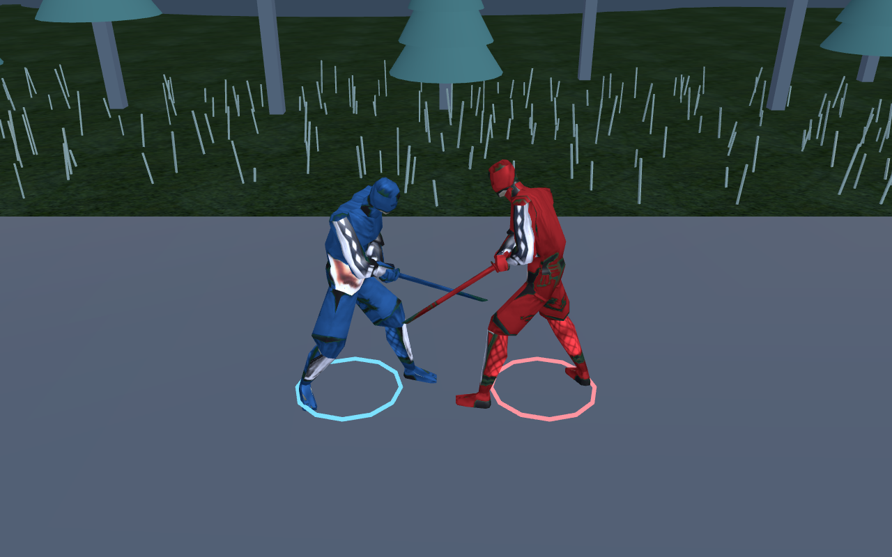
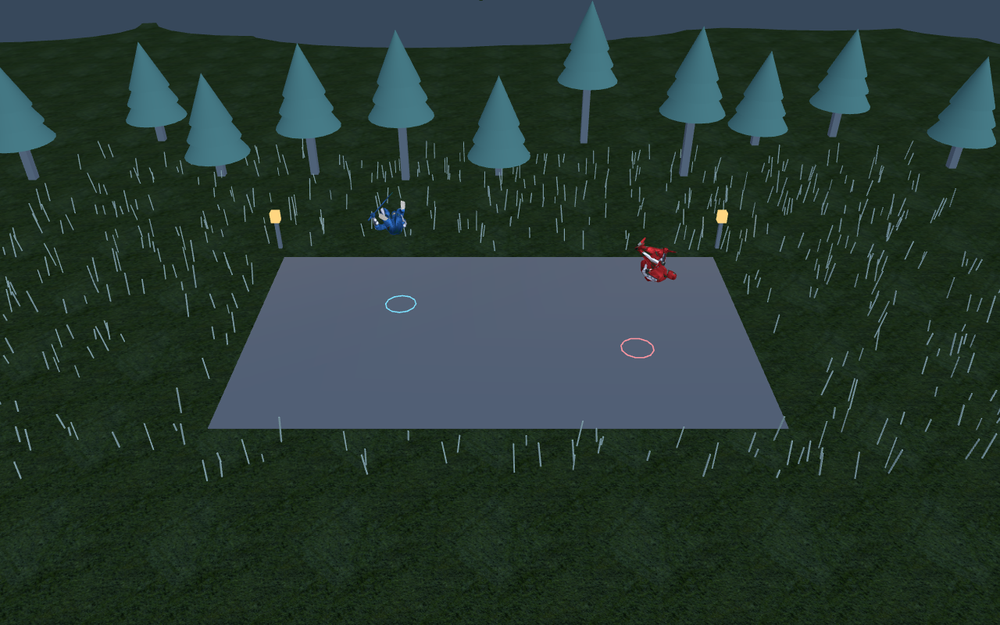

# Issue 10: two-handed swords and directional flips

Work: [issue #10](https://github.com/tbizz46/JMonkeyEngine-Ninja-Game/issues/10).
This list covers the new work after the audio feature in PR #9.

## Player controls

- **J**: two-handed overhead sword strike.
- **Hold WASD or an arrow, then press F**: flip in that ground direction.
- **F alone**: flip in the ninja's current facing direction.
- **Escape**: pause, including an active flip. Resume keeps its progress.

The move uses the bundled backflip animation. The ninja turns so its
backward tumble travels in the requested direction. Direction is fixed at
launch; changing keys during the move does not steer it. Both ninjas can
use the two-handed strike and flip. The computer may flip away from an
incoming attack.

The first image uses a close test camera to show the grip. Normal play
keeps the angled arena camera. Both images are scene exports before the HUD.

## All code changes

1. **`src/mygame/DuelState.java` — sword**: changed the shared sword strike
   from `Attack1` to the bundled overhead `Attack3` clip. Both fighters use
   it. Existing sword damage, reach, hit time, and cooldown are retained.
2. **`DuelState.java` — flip state**: added flip time, direction, cooldown,
   and constants: 0.85-second duration, 3.6-unit travel, 2-unit game-state
   height, and 1.35-second cooldown from launch.
3. **`DuelState.java` — launch and feedback**: added `flip(fighter, dx, dz)`.
   It normalizes directions, uses facing if no direction is given, and
   rejects invalid launch states. The player gets a retry hint for cooldown,
   being in the air, blocking, striking, or recovering from a hit.
4. **`DuelState.java` — travel and landing**: advances a fixed direction in
   X/Z, clamps at arena bounds, updates the airborne hit height, and emits
   one landing event. Flips cannot be steered or combined with a new strike
   or jump. Their timers and movement freeze while paused.
5. **`DuelState.java` — facing and spacing**: keeps facing fixed during the
   tumble. Body spacing allows a fighter to pass over another with enough
   height clearance, then resolves spacing again on landing. Reset clears
   flip state and cues along with the rest of the round.
6. **`src/mygame/NinjaCombatPose.java`**: added a rig-specific pose control.
   It blends into the two-handed grip during the overhead strike. A
   two-bone arm solver moves both arms toward a shared grip, keeps the
   support hand eight model units behind the sword hand, and preserves the
   blade direction. It changes arm rotations, not the mesh or texture.
   It also removes the backflip clip's horizontal root motion, so ground
   travel is controlled once by the game state. Native vertical animation
   is retained; the renderer does not add the state height a second time.
7. **`src/mygame/Main.java` — animation**: attaches a separate combat pose
   control to each ninja. Sword strikes use the grip correction. Active
   flips use `Backflip` at the move's speed and its vertical pose. The
   fighter's ground position still comes from X/Z state.
8. **`Main.java` — input and help**: maps F, passes the held movement
   direction to the flip, and updates the start help and control strip.
   Block is prevented during a flip. Existing move, kick, jump, pause,
   music, effects, and quit keys are kept.
9. **`Main.java` — computer opponent**: adds a chance to flip away when an
   incoming strike is first noticed. It uses the same launch rules and
   cooldown as the player. Blocking and attack attempts respect flip state.
10. **`Main.java` — live checks**: extends the smoke sequence to run both
    two-handed strikes, inspect live grip spacing, run two flip directions,
    check animation and travel, pause mid-flip, resume, land, and rematch.
    It requests close strike and wide flip evidence frames.
11. **`src/mygame/GameAudio.java`**: maps the confirmed FLIP event to the
    existing jump whoosh. Landing uses the existing landing cue. No new
    audio file or dependency is needed.
12. **`src/mygame/UniformRenderCheck.java`**: allows requested evidence
    frames after the original blue/red pixel check has passed. Existing
    uniform checks stay in place.
13. **`tests/mygame/NinjaCombatPoseTest.java`**: samples the configured
    sword clip at five contact phases. It checks grip spacing, unchanged
    blade direction and foot pose, and removal of horizontal flip root
    motion. The measured hand spacing is about eight model units.
14. **`tests/mygame/FlipTest.java`**: checks eight directions, equal diagonal
    distance, facing fallback, fixed travel, arena corners, overhead dodge,
    CPU use, cooldown, retry hints, invalid action states, pause/resume,
    landing, one launch/landing cue pair, and clean rematch state.
15. **`tests/mygame/GameAudioTest.java`**: checks one flip/landing cue pair
    and decodes each unique WAV file once when cues share an asset.
16. **`run.command`**: adds the rig-pose and flip suites to `--test`.
17. **`README.md`**: documents the two-handed strike, F controls, and this
    change list. This guide and the two evidence images record the result.
18. **Local build**: rebuilds `dist/Night Ninja Duel.app` with the changes.
    Build output remains excluded from Git.

## Verification

`./run.command --test` passed combat, imports, audio, rig-pose, and flip
checks on Apple M3. The source live test passed both two-handed grips,
both directional flip animations, travel, pause/resume, landing, uniforms,
native audio, kicks, victory, and rematch. The exported images were
visually inspected. The rebuilt Mac app passed the same live checks,
including both grip checks at about eight model units and both flips.
`git diff --cached --check` passed.

The grip checks use the model's right grip and left wrist joints. They
test five contact phases and the live animated actors, not just an action
name. The flip hit height is a game-state arc; the visible pose uses the
authored animation. This is not a rigid-body or cloth simulation.

## Usability scope and gaps

The task starts at the normal Enter screen, then J or direction + F.
Success is a visible two-handed strike or a tumble in the requested
direction, followed by a safe landing. Existing keys remain consistent.
Help is visible at start and during play. A rejected flip explains the
next step. Pause and rematch retain their existing recovery paths.

The in-scope review considered visible results, player terms, recovery,
key consistency, invalid actions and bounds, visible help, repeat use,
fight focus, retry feedback, and point-of-use examples. Source and tests
cover these paths; no further issue was found in that scope. Manual F-key
play, HUD layout, long balance sessions, other rigs, and other platforms
were not verified. Render evidence excludes the HUD.

## Repository integration

Earlier arena, uniform, and audio PRs were merged into feature branches,
so main did not contain the full latest game when this work began. This
PR targets main and carries that previously reviewed work forward as
well as issue 10. Their original commits and change guides are retained.
