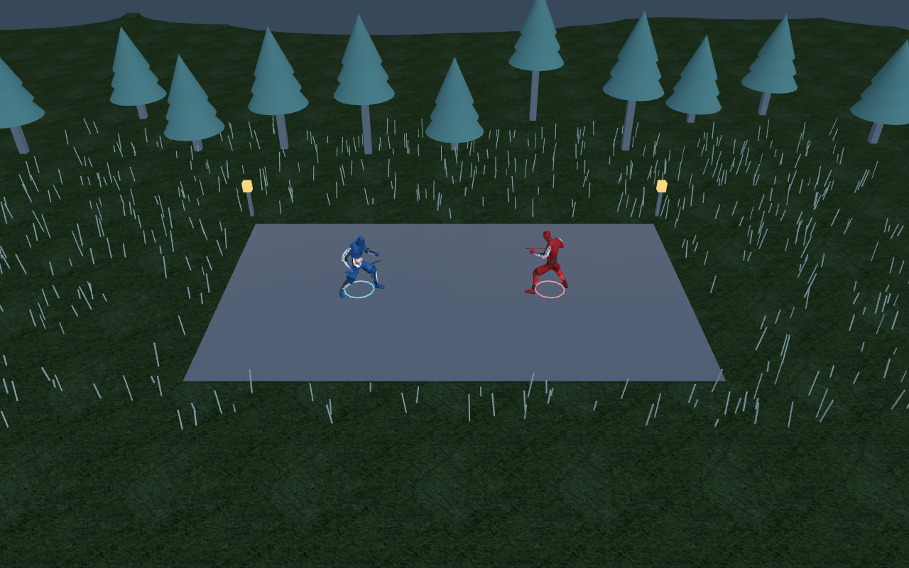

# Issue 6: blue player and red CPU uniforms

The player's ninja wears blue cloth. The CPU's ninja wears red cloth.
Both colors match the roles already named in the health bars and floor
markers. The source ninja texture remains intact.

This image is exported from the game's rendered scene before the HUD pass.
It was inspected to confirm the two uniforms are easy to tell apart.

## Changed files

- `src/mygame/NinjaUniform.java`: creates a separate material for each
  fighter with blue or red as its cloth color and the original texture.
- `src/mygame/Main.java`: passes the player/CPU role into Avatar, applies
  its uniform at load time, and enables the render check in smoke tests.
- `assets/MatDefs/NinjaUniform.j3md`: defines a lit, skinned ninja material
  with a fighter-specific color parameter.
- `assets/Shaders/NinjaUniform.frag`: selects green cloth from the source
  texture and maps its shaded brightness to blue or red. Areas without
  green dominance keep their skin and metal color.
- `assets/Shaders/JmePhongLighting.glsllib`: jME 3.9.0's standard fragment
  lighting code, copied as an importable shader library. Only attribution,
  whitespace, and the file extension differ from the engine source.
- `assets/Shaders/JME-LICENSE.txt`: retains the engine's BSD license.
- `src/mygame/UniformRenderCheck.java`: samples torso pixels after the
  scene renders and before the HUD pass. It rejects a missing/wrong
  uniform color and exports `.runtime/uniforms-render.png` when the source
  smoke test is run. The check only runs with `--smoke`.
- This guide, the README link, and the render evidence record the result.

## Checks performed

- `./run.command --test` passed the combat and model-import checks.
- `./run.command --smoke` passed actual GPU torso-color checks, both
  kick animations, movement, pause, victory, and rematch.
- `./package-mac.command` rebuilt the local Mac app.
- The rebuilt app passed the same GPU and fight smoke checks.
- The source render had 278 blue torso pixels and 299 red torso pixels;
  the packaged app had 283 and 297. Each check requires at least 12
  matching pixels in each torso region, above the floor rings.
- The exported scene image was visually inspected. Cloth colors are
  distinct and the original sword and light armor details remain visible.

The runtime shader uses jME's lighting and hardware skinning. Future
engine upgrades should review the copied 3.9.0 lighting library. Testing
covered macOS Apple Silicon; other graphics drivers were not tested.

## Usability review

The player must identify their ninja when the round starts and while the
fighters move around each other. The prior two green uniforms made that
harder (H6: put choices and context where they are needed). The uniforms
now carry the same player/CPU color meaning as the existing HUD and rings
(H4: keep familiar actions consistent).

The reviewed scope was fighter identity in the rendered Mac arena. No
additional issue was found for this scope across the ten project principles.
The scene export excludes menus and the HUD. A new manual keyboard play
session, other displays, and other platforms were not part of this check.
